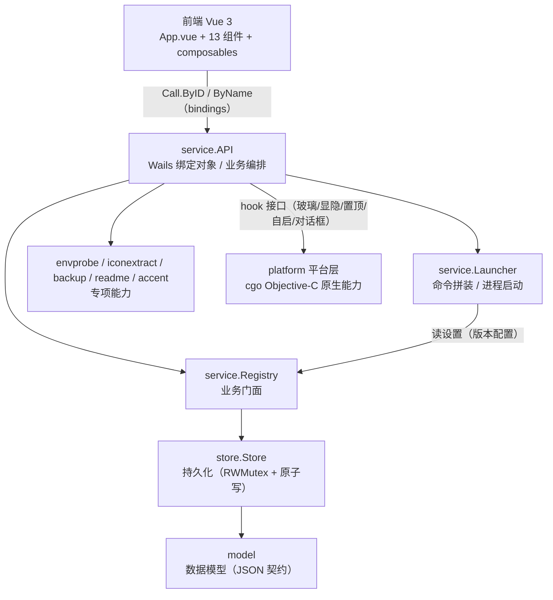

# Armory · 渗透工具军械库

> macOS 渗透工具 **收纳 / 启动器** —— Spotlight 式无边框毛玻璃悬浮面板。
> 把 `.app / .jar / .py / .sh / 二进制 / 网页` 收录成卡片，可搜索、分类、拖拽收录，
> 可指定 Java / Python 运行时启动；支持图标提取、说明文档渲染、备份导入导出、
> 主题 / 字体 / 动效设置。全局热键（默认 `⌥Space`）随时呼出。

<p align="left">
  
  
  
  
  
</p>

> **使用声明**：本项目是面向授权场景的本地工具管理器。请在**合法授权**范围内使用（自有资产、
> 明确授权的渗透测试 / 红队演练 / CTF / 安全研究）。作者不对任何未授权使用承担责任。

---

## 目录

- [一、项目简介](#一项目简介)
- [二、功能特性](#二功能特性)
- [三、界面布局](#三界面布局)
- [四、快速开始](#四快速开始)
- [五、功能使用教程](#五功能使用教程)
  - [5.1 呼出与隐藏面板](#51-呼出与隐藏面板)
  - [5.2 收录工具（三种方式）](#52-收录工具三种方式)
  - [5.3 工具类型与启动方式](#53-工具类型与启动方式)
  - [5.4 JVM 参数 / 工作目录 / 终端运行](#54-jvm-参数--工作目录--终端运行)
  - [5.5 分类体系（主分组 / 分组）](#55-分类体系主分组--分组)
  - [5.6 搜索与命令视图](#56-搜索与命令视图)
  - [5.7 标签（跨工具多对多归类）](#57-标签跨工具多对多归类)
  - [5.8 运行环境配置（Java / Python）](#58-运行环境配置java--python)
  - [5.9 图标与说明文档](#59-图标与说明文档)
  - [5.10 备份与还原](#510-备份与还原)
  - [5.11 外观与行为设置](#511-外观与行为设置)
  - [5.12 最近使用](#512-最近使用)
  - [5.13 数据存储位置](#513-数据存储位置)
- [六、目录结构](#六目录结构)
- [七、设计思路与架构分析](#七设计思路与架构分析)
- [八、源码构建](#八源码构建)
- [九、绑定 API 参考](#九绑定-api-参考)
- [十、测试与验证](#十测试与验证)
- [十一、已知约束与兼容性](#十一已知约束与兼容性)
- [十二、项目文档](#十二项目文档)
- [十三、License 与致谢](#十三license-与致谢)

---

## 一、项目简介

**Armory** 是一个个人专用的 macOS 桌面工具管理器，用于集中收纳渗透作业中频繁使用的各类
工具与脚本，并以「搜索即启动」的方式快速调用。它采用 **Wails v3（Go 后端）+ Vue 3（前端）**
构建，前端构建产物通过 `go:embed` 内嵌进单一可执行文件，运行时由 Wails 资产服务器提供。

| 属性 | 值 |
|---|---|
| 应用名称 | Armory（早期代号 Vulpes / 狐狸洞） |
| Bundle Identifier | `com.armory.launcher` |
| 版本 | `0.1.0` |
| 数据目录 | `~/.armory/`（`tools.json` + `cache/icons/*.png`） |
| 默认全局热键 | `⌥Space`（Option + Space，固定不可改） |
| 目标平台 | macOS 26+（原生 Liquid Glass），arm64 |
| 分发方式 | GitHub Releases 提供 `.app` / `.dmg`；源码仓库不含构建产物 |

**设计目标**：在**完全兼容**原版 `~/.armory/tools.json` 数据格式的前提下，把数据持久化、
业务编排、平台原生能力彻底分层，获得更清晰的架构、更可靠的错误处理与更易维护的前端工程。

---

## 二、功能特性

| 能力 | 说明 |
|---|---|
| 🗂 多类型收纳 | 支持 `app / jar / py / sh / bin / url` 六种类型，自动按扩展名识别 |
| 🔍 搜索即启动 | 顶栏输入即进入命令视图，支持名称 / 路径 / 标签 / 类型 emoji 命中，`↑↓` 选择、`⏎` 启动 |
| 🧲 拖拽收录 | 把 `.app/.jar/.py/.sh/二进制` 直接拖进面板即收录；拖到指定分组可定向归档 |
| 🗃 两级分类 | 侧栏「主分组」+ 页面内「分组分节」，可折叠、可拖拽排序、可右键管理 |
| 🏷 标签体系 | 跨工具的多对多标签，支持页内标签筛选 chips、批量重命名 / 删除 |
| ☕ 多运行时 | 配置多个 Java / Python 版本，按工具选择解释器；启动时注入 `JAVA_HOME` / `PATH` |
| 🖼 真实图标 | 从 `.app` 自动提取原版 icns 图标并转 PNG 缓存；历史条目自动回填 |
| 📄 说明文档 | 读取工具目录下 `README.md / 说明.txt` 等，内嵌 Markdown 渲染 |
| 💾 备份还原 | 一键打包 `tools.json` + 全部图标为 zip；导入还原前自动留底 |
| 🎨 外观设置 | 主题（自动/浅/深）+ 原生玻璃明暗联动、字体缩放（标准/大/特大）、减弱动效 |
| 🪟 系统集成 | 开机自启（登录项）、窗口置顶、系统强调色读取、红绿灯保留原生行为 |
| ⌨️ 全局热键 | Carbon `RegisterEventHotKey` 注册 `⌥Space`，Launchpad 式淡入淡出 |

---

## 三、界面布局

```
┌────────────┬──────────────────────────────────────────────────────┐
│  Armory    │  🔍 搜索工具，或直接键入启动…            ⌥Space   ＋  ⚙ │  ← 顶栏
│            ├──────────────────────────────────────────────────────┤
│  ▦ 全部    │  [标签 chips：全部 · 内网 · 免杀 · 提权 …]              │
│  🕘 最近   │                                                      │
│  📁 信息收集│  主分组 / 分组分节 ▾                        （可折叠）  │
│  📁 漏洞利用│   ┌──────┐ ┌──────┐ ┌──────┐ ┌──────┐               │
│  📁 代理隧道│   │ 🚀   │ │ ☕   │ │ 🐍   │ │ ＋   │               │
│  📁 开发日常│   │ 名称 │ │ 名称 │ │ 名称 │ │ 添加 │               │
│            │   └──────┘ └──────┘ └──────┘ └──────┘               │
│  ＋ 新建   │                                                      │
└────────────┴──────────────────────────────────────────────────────┘
```

- **侧栏**：品牌 + 「全部 / 最近」+ 主分组列表（带工具计数徽标，可拖拽排序）+ 新建入口。
- **顶栏**：搜索框（`⌥Space` 提示）、添加工具、设置。
- **内容区**：网格视图（卡片）或命令视图（列表），随搜索词自动切换。

---

## 四、快速开始

### 系统要求

- macOS **26 及以上**（依赖原生 Liquid Glass 与 `NSGlassEffectView`），**arm64**（Apple Silicon）。
- 运行打包产物无需安装 Go / Node，双击即可。

### 安装（推荐）

1. 前往 **GitHub Releases** 下载最新的 `armory.dmg`（或 `armory.app`）。
2. 打开 `.dmg`，将 **Armory** 拖入 `Applications`。
3. 首次打开如被 Gatekeeper 拦截，右键 →「打开」，或在「系统设置 → 隐私与安全性」中允许。
   （本项目使用 **ad-hoc 签名**，非 Apple 公证。）

### 首次启动

- 应用启动后即显示面板；之后用 **`⌥Space`** 随时呼出 / 隐藏。
- 首次运行会在 `~/.armory/` 下自动生成 `tools.json`，并内置 4 个默认主分组：
  **信息收集 / 漏洞利用 / 代理隧道 / 开发日常**。
- 若本机已有原版数据，Armory 会**直接读取** `~/.armory/tools.json`，无需迁移。

---

## 五、功能使用教程

### 5.1 呼出与隐藏面板

- **全局热键**：任意界面按 `⌥Space` 呼出 / 隐藏面板（Launchpad 式 0.18s 淡入、0.15s 淡出）。
- **Esc**：按层级依次关闭——编辑 → 添加 → 分类 → 设置 → 命令视图（清空搜索）→ 隐藏面板。
- **启动工具后**：面板会在约 320ms 后自动收起（Spotlight 行为），并刷新「最近」。
- **退出应用**：`⌘Q`，或菜单「退出」。（面板隐藏 ≠ 退出，进程常驻后台以响应热键。）

> 提示：由于关闭最后一个窗口不退出应用（`ApplicationShouldTerminateAfterLastWindowClosed=false`），
> 点击红绿灯的红色按钮只会隐藏窗口，请用 `⌘Q` 退出。

### 5.2 收录工具（三种方式）

**方式一：拖拽收录（最快）**
1. 在 Finder 选中 `.app / .jar / .py / .sh / 可执行文件`。
2. 拖进面板，面板底部提示「松手即可收录到「当前分组」」。
3. 松开后自动识别类型、提取图标（`.app`）并归入当前分组。

**方式二：添加对话框**
1. 点顶栏 **＋** 或网格末尾「添加」卡片。
2. 填写：
   - **路径**（必填）：如 `/Applications/Burp Suite.app` 或 `~/Tools/x.jar`，支持 `~` 与环境变量。
   - **工具名称**（选填）：留空则自动取文件名 / `.app` 包名。
   - **启动参数**（选填）：如 `-sV -p 1-65535`，按 shell 风格解析（支持单双引号）。
   - **所属分类**：按「主分组 / 分组」分组展示的下拉。
3. 点「添加工具」。

**方式三：收录网页工具（URL）**
- 在「路径」中填 `https://example.com`，类型自动识别为 `url`，点击卡片用系统默认浏览器打开。

> 防呆：同一路径不允许重复收录；收录时会校验路径是否存在。
> 拖拽传入的 `file://` 前缀会被自动剥离。

### 5.3 工具类型与启动方式

| 类型 | 识别方式 | 启动命令（等价） |
|---|---|---|
| `app` | `.app` 结尾 / 目录 | `open <path> [--args <args>]`（LaunchServices） |
| `jar` | `.jar` 结尾 | `<java> [jvmArgs] -jar <path> [args]` |
| `py` | `.py` 结尾 | `<python> <path> [args]` |
| `sh` | `.sh / .command / .zsh` | `/bin/sh <path> [args]` |
| `bin` | 其它可执行文件 | `<path> [args]` |
| `url` | `http://` / `https://` 前缀 | `open <url>` |

- **点击卡片**即启动；**右键卡片**打开编辑对话框。
- 网格视图：`⏎` 启动、`⌘⏎` 编辑；命令视图：`⏎` 启动、`⌘⏎` 编辑。

### 5.4 JVM 参数 / 工作目录 / 终端运行

在**编辑工具**对话框中（按类型显示）：

- **JVM 参数**（仅 `jar`）：拼在 `-jar` **之前**，如 `-noverify -javaagent:agent.jar`。
  > 注意：不要在这里写 `-jar`，程序 jar 由「路径」自动拼接；`-jar` 之后的参数请放到「启动参数」。
- **启动参数**：传给程序本身（`jar` 时位于 `-jar` 之后）。
- **工作目录**（`jar/bin/sh/py`）：留空默认取**工具所在目录**，便于相对路径引用 `-javaagent`、脚本资源与配置。
- **终端运行**（`bin/sh/py`）：勾选后新开「终端」窗口执行，自动 `cd` 到工具目录，
  输出与交互可见（适合交互式 CLI 工具，窗口执行结束后保留）。
- **保存**后立即生效。

### 5.5 分类体系（主分组 / 分组）

Armory 采用**两层结构**（Maye 式布局）：

- **主分组**（一级，`parentId` 为空）：显示在**侧栏**，是独立的工具页面。
- **分组**（二级，挂在某主分组下）：显示在主分组**页面内**，作为可折叠的「分节」收纳工具。
- 层级约束：分组下**不能再嵌套**；侧栏只显示主分组。

**操作方式**
| 操作 | 入口 |
|---|---|
| 新建主分组 / 分组 | 侧栏底部 **＋ 新建**，在「所属层级」下拉选择「主分组」或「某主分组内的分组」 |
| 重命名 / 删除 | 右键主分组长或分节头 →「重命名 / 删除」 |
| 新建分组（快捷） | 右键主分组长 →「新建分组」 |
| 拖拽排序 | 直接拖动侧栏主分组或页内分节头（仅同层内生效） |
| 折叠分节 | 点击分节头（折叠状态跨会话记忆） |
| 工具改归属 | 把卡片拖到侧栏主分组 / 页内分节头（高亮提示落点） |
| 卡片排序 | 在同分组内把卡片拖到另一张卡的上/下半区 |

**删除语义**：至少保留一个分类；删除分组时，其直属工具归入上级分类；删除主分组时，
其下分组提升为顶层，避免产生孤儿分类。删除前会明确提示受影响的工具数量与后果。

### 5.6 搜索与命令视图

- 在顶栏搜索框输入任意关键词，界面自动切换为**命令视图**（列表）；清空搜索回到网格视图。
- **匹配范围**：名称、路径、标签、类型 emoji / 类型名（如 `🚀 ☕ 🐍 ⌨️ 🔧`、`App/JAR/...`）。
- **命中高亮**：名称中命中的片段以 `<mark>` 高亮。
- **键盘操作**：`↑ / ↓` 移动选择，`⏎` 启动，`⌘⏎` 编辑。
- **全局搜索**：命令视图按「命中工具各自的主分组」归节，跨分组也能一次搜到。
- 在命令视图点击分区头可进入该分类（并自动切回网格视图）。

### 5.7 标签（跨工具多对多归类）

- **添加标签**：编辑工具对话框 →「标签」输入框，回车添加；输入时自动补全全库已有标签。
- **筛选**：网格视图顶部出现标签 chips（按使用次数排序，超过 8 个折叠进「更多」），点击即筛选。
- **批量管理**：右键标签 chip →
  - **重命名标签**：全库所有工具上的该标签一次性改名（自动去重）；
  - **删除标签**：从所有工具上移除该标签（工具本身不受影响，删除前提示涉及工具数）。

### 5.8 运行环境配置（Java / Python）

**设置 → Java 环境 / Python 环境**：

1. 点「⟳ 扫描本机」自动探测：
   - **Java**：优先 `/usr/libexec/java_home -V`，兜底扫描 `~/Library/Java/JavaVirtualMachines` 等；不把系统存根当版本。
   - **Python**：收集 pyenv / Homebrew / python.org / conda 等候选，实际执行 `--version` 取准确版本；symlink 别名合并去重。
2. 扫描结果按路径合入列表，同名不同版本用全版本号区分（如三个 JDK 8）。
3. 也可「＋ 添加版本」手动填「版本名 + 可执行文件路径」。
4. 点「保存」立即生效（提示「XX 环境已保存，立即生效」）。

**如何使用**：
- 编辑 `jar` 工具 →「Java 版本」下拉选择；编辑 `py` 工具 →「Python 版本」下拉选择。
- 选择「自动（系统默认）」则用系统解释器。
- 启动时会按所选版本执行，并为 `jar/py` 注入 `JAVA_HOME` / `PATH` 前置（部分工具依赖环境变量认版本）。
- 若配置的解释器不存在，启动回退链依次为：配置版本 → PATH → 系统默认（`java_home` / `/usr/local/bin/python3`）。

### 5.9 图标与说明文档

- **图标**：`.app` 收录时自动读取 `Info.plist` 的 `CFBundleIconFile`，兜底取第一个 `.icns`，用系统 `sips` 转 PNG
  缓存到 `~/.armory/cache/icons/<id>.png`。启动时会为历史缺失图标的条目**自动回填**。
- **说明文档**：在工具所在目录放置 `README.md / README.txt / 说明.txt / 使用说明.md` 等，
  编辑该工具时会在对话框底部以 Markdown 渲染展示（支持标题、代码块、列表、行内格式）。

### 5.10 备份与还原

**设置 → 数据**：

- **导出备份**：把 `tools.json` + 全部图标打包成 zip，默认名 `armory-backup-<YYYYMMDD-HHMMSS>.zip`，
  通过系统保存对话框选择位置。
- **导入还原**：选择备份 zip → 整包覆盖还原（两步确认，防误触）。
  - 覆盖前**自动留底**：当前数据快照写入 `~/.armory/tools.json.bak-<时间戳>`，误还原可手动找回。
  - 还原后自动重载并应用设置（主题 / 字号 / 动效 / 自启 / 置顶）。

> 兼容性：也能识别按原版 `cache/icons/` 目录布局打包的备份。

### 5.11 外观与行为设置

**设置面板分区**：

| 分区 | 项 | 说明 |
|---|---|---|
| 通用 | 开机自启 | 登录时自动启动（macOS 13+ 走 `SMAppService` 登录项，回退 LaunchAgent） |
| 通用 | 窗口置顶 | 面板始终浮于其它窗口之上 |
| 外观 | 主题 | 自动 / 浅色 / 深色；切换深色时同步给原生玻璃叠加暗色 tint，避免对比度崩坏 |
| 外观 | 界面字体 | 标准（1.0）/ 大（1.1）/ 特大（1.2）全局缩放，立即生效 |
| 外观 | 减弱动态效果 | 动画降级；跟随系统「减弱动态效果」自动生效 |
| 快捷键 | `⌥Space` | 固定热键，任何界面按下即生效（不可自定义） |

> 强调色：启动时读取 macOS 全局偏好 `AppleHighlightColor` 作为界面强调色，未设置回退系统蓝 `#0a84ff`。

### 5.12 最近使用

- 侧栏「最近」展示最近运行过的工具（默认取前 12 个，按最近运行时间倒序）。
- 每次启动成功会记录 `runCount + 1` 并刷新 `lastRunAt`；编辑工具时可看到「已运行 N 次 · 最近时间」。

### 5.13 数据存储位置

```
~/.armory/
├── tools.json                # 全部工具 / 分类 / 设置（0600，含敏感资产清单）
├── tools.json.tmp            # 原子写临时文件（写入后 rename 覆盖）
├── tools.json.bak-<时间戳>    # 导入还原前的自动留底
└── cache/
    └── icons/
        └── <toolID>.png      # .app 提取的图标缓存
```

> `tools.json` 顶层结构为 `{ "Tools": [...], "Categories": [...], "Settings": {...} }`，
> 字段名与 JSON tag 与历史版本完全一致，可直接互通。

---

## 六、目录结构

```
Armory/
├── main.go                       # 应用装配入口：数据层/API、创建窗口、注册热键、
│                                 #   注入平台 hook（玻璃/显隐/置顶/自启/对话框）、拖放转发
├── go.mod / go.sum               # Go 模块（module armory；依赖 wails v3 beta.26）
├── Makefile                      # 一键构建封装（内置沙箱所需环境变量）
├── Taskfile.yml                  # wails3 精简构建脚本（前端/编译/打包/dmg/run/dev）
│
├── internal/
│   ├── model/
│   │   └── model.go              # 数据模型：Tool / Category / RuntimeVersion / Settings / RegistryData
│   │
│   ├── store/
│   │   └── store.go              # 持久化层：RWMutex 读写分离、.tmp+rename 原子写、
│   │                             #   深拷贝快照、默认分类、两级分类树、标签批量操作、~/.armory 兼容
│   │
│   ├── service/                  # 业务逻辑层（与平台层、持久化层解耦）
│   │   ├── api.go                # Wails 绑定对象（业务方法 + 平台 hook 注入）
│   │   ├── registry.go           # Registry 门面：委托 store，供 API 依赖注入
│   │   ├── launcher.go           # 启动器：按类型/运行时拼装命令、终端运行、参数解析、环境注入
│   │   ├── envprobe.go           # 扫描本机 Java / Python 运行时（去重、排序、命名）
│   │   ├── iconextract.go        # 从 .app 提取 icns 并用 sips 转 PNG
│   │   ├── readme.go             # 读取工具目录下的说明文档
│   │   ├── backup.go             # 导出/导入 zip 备份（含自动留底、原版布局兼容）
│   │   ├── accent.go             # 读取 macOS 系统强调色（AppleHighlightColor）
│   │   ├── util.go               # 路径展开 / 序列化 / 文件名辅助
│   │   └── *_test.go             # 46 个单元测试（启动/环境/备份/分类/标签/兼容等）
│   │
│   └── platform/                 # macOS 原生能力隔离层（业务层只经 hook 调用）
│       ├── window_options.go     # 主窗口统一配置（全平台共享：880×560、无边框、Liquid Glass）
│       ├── window.go             # //go:build darwin && cgo  —— CreateMainWindow
│       ├── window_anim.go        # //go:build darwin && cgo  —— 原生淡入/淡出（Objective-C + cgo）
│       ├── glass_tint.go         # //go:build darwin && cgo  —— 玻璃深浅 tint（NSGlassEffectView）
│       ├── trafficlights.go      # //go:build darwin && cgo  —— 恢复原生红绿灯按钮
│       ├── hotkey.go             # //go:build darwin && cgo  —— Carbon 全局热键 ⌥Space
│       ├── loginitem.go          # //go:build darwin && cgo  —— 开机自启（Wails AutostartManager）
│       ├── platform_darwin_nocgo.go  # //go:build darwin && !cgo —— 纯 Go 回退（无动画/热键报错）
│       └── platform_stub_other.go    # //go:build !darwin       —— 非 macOS 可编译回退
│
├── frontend/                     # Vue 3 + Vite 前端
│   ├── index.html                # 挂载点 <div id="app">
│   ├── package.json              # 依赖：vue 3.5、@wailsio/runtime、vite 5
│   ├── vite.config.js            # base:'./'，产物固定输出 dist（供 go:embed）
│   ├── src/
│   │   ├── main.js               # createApp 挂载 + 引入全局样式
│   │   ├── App.vue               # 主容器：状态编排、数据加载、事件接线、视图切换（~1160 行）
│   │   ├── components/           # 13 个 UI 组件
│   │   │   ├── Sidebar.vue       #   侧栏：主分组 / 计数徽标 / 拖拽排序 / 右键
│   │   │   ├── TopBar.vue        #   顶栏：搜索框 + 添加 + 设置
│   │   │   ├── ToolGrid.vue      #   网格视图：卡片 / 分节 / 标签 chips / 拖拽
│   │   │   ├── CmdList.vue       #   命令视图：分区列表 / 搜索高亮 / 键盘选择
│   │   │   ├── AddDialog.vue     #   添加工具对话框
│   │   │   ├── EditDialog.vue    #   编辑工具对话框（JVM/工作目录/终端/标签/说明文档/两步删除）
│   │   │   ├── CategoryDialog.vue#   分类新建/重命名
│   │   │   ├── SettingsDialog.vue#   设置面板（通用/外观/环境/快捷键/收录/数据）
│   │   │   ├── ConfirmDialog.vue #   通用危险操作确认弹窗
│   │   │   ├── PromptDialog.vue  #   单行输入弹窗（如重命名标签）
│   │   │   ├── ContextMenu.vue   #   右键上下文菜单（自校准定位）
│   │   │   ├── NameTip.vue       #   长名称悬浮提示
│   │   │   └── Toast.vue         #   轻量提示条
│   │   ├── composables/          # 3 个组合式函数
│   │   │   ├── useApi.js         #   后端调用封装（bindings 主 + methodID 回退）+ 事件订阅
│   │   │   ├── useMarkdown.js    #   极简 Markdown 渲染
│   │   │   ├── useToolType.js    #   前端类型识别（与后端 DetectType 一致）
│   │   │   └── useCatOptions.js  #   分类下拉选项（按主分组归组）
│   │   ├── styles/
│   │   │   └── style.css         # 原版样式（与产物 sha1 一致）
│   │   └── bindings/             # wails3 generate bindings 生成的官方 TS bindings
│   └── dist/                     # 前端构建产物（被 go:embed 内嵌；构建生成，不提交）
│
├── build/                        # wails3 打包脚手架（Info.plist / icons.icns / dmg 资源）
│   ├── config.yml
│   └── darwin/
│       ├── Info.plist  Info.dev.plist  Info.original.plist
│       ├── icons.icns  Assets.car
│       ├── dmg-background.png  dmg-file-icon.icns  dmg-file-icon.png
│       └── Taskfile.yml
│
├── docs/                         # 设计与契约文档（见第十二节）
│   ├── CONVENTIONS.md            #   团队协作约定与技术规范
│   ├── INTERFACE.md              #   main ↔ service ↔ platform 接口契约
│   ├── DIFF-vs-original.md       #   与原版 Armory 的还原度对比（实测）
│   ├── RUNNING-APP-FEATURES.md   #   原版运行功能全景（取证）
│   ├── GAP-ANALYSIS-vs-installed-original.md
│   ├── RESTORE-DONE.md / RESTORE-GAPS.md
│   ├── orig-frontend-9.27/       #   原版内嵌前端字节（对照用）
│   └── orig-src-snapshot-9.26/   #   原版源码快照（对照用）
│
├── recovered/                    # 原始恢复源码（功能基线对照，不参与构建，已 gitignore）
└── bin/                          # 构建产物（.app / .dmg / 裸可执行，已 gitignore）
```

> 说明：`internal/` + `main.go` 约 4,350 行 Go；`frontend/src` 约 2,730 行（含样式）。

---

## 七、设计思路与架构分析

### 7.1 分层架构

Armory 的核心设计原则是**关注点分离**：把「数据」「业务」「平台原生」「界面」四层彻底拆开，
每一层只依赖下一层的抽象，平台细节绝不泄漏到业务代码中。



**依赖方向**：`main → service → (store, platform, model)`。`platform` 不反向依赖 `service`，
`store` 不依赖 `service`。业务层通过**函数 hook 接口**（`SetGlassHook / SetHideHook / SetShowHook /
SetTopHook / SetLoginHook / SetDialogHooks`）间接调用平台能力，`main.go` 在启动时把 Wails 窗口、
原生函数接到这些 hook 上——这样业务逻辑完全可单测，平台实现可替换、可降级。

### 7.2 后端设计要点

**① 持久化与业务剥离（`internal/store`）**
- `sync.RWMutex` 读写分离：纯读路径共享读锁，写路径独占锁。
- **原子写**：先写 `tools.json.tmp`，`rename` 覆盖，杜绝半截文件；文件权限 `0600`（含敏感资产清单）。
- **深拷贝快照**：`Snapshot()` 复制切片，避免调用方与内部数据共享底层数组。
- **默认分类**：首次启动写入「信息收集 / 漏洞利用 / 代理隧道 / 开发日常」，ID 方案 `cat-<名称>`。
- **两级分类树**：`ListCategories()` 按树序输出（子项紧跟父项）；`ListTools(cat)` 返回整棵子树，
  保证前端分节渲染与「空分类默认归属」正确。
- `service.Registry` 只是门面，把并发与落盘全部委托 `store`。

**② 启动器（`service/launcher.go`）**
- 按 `Tool.Type` 分派：`app` 走 `open`（带 `--args`），`url` 走 `open`，`jar` 走 java（JVM 参数在 `-jar` 前），
  `py` 走 python，`sh` 走 `/bin/sh`，`bin` 直接执行。
- `SplitArgs`：shell 风格参数切分（支持单双引号），正确处理空参数与带引号片段。
- **工作目录**：显式 `WorkingDir` 优先，否则 `jar/bin/sh/py` 默认取工具所在目录。
- **终端运行**：用 `osascript` 让 Terminal 新窗口执行 `cd <dir> && <cmd>`，交互工具输出可见。
- **环境注入**：命中全局配置版本时注入 `JAVA_HOME` / `PATH` 前置；未命中保持系统默认，行为一致。
- **友好错误**：`exec.Error`（解释器缺失）翻译为「请确认已安装 / 可在设置中配置版本」，不直接抛底层报错。
- 启动成功后 `MarkRun` 记录次数与时间；后台 `Wait()` 回收进程，避免僵尸。

**③ 运行时扫描（`service/envprobe.go`）**
- Java：`/usr/libexec/java_home -V` 解析（兼容 macOS 26 行格式），兜底扫目录；**不把 PATH 存根当版本**。
- Python：按「用户管理优先于系统自带」收集候选（pyenv > Homebrew > /usr/local > python.org > conda > /usr/bin > PATH），
  实际执行 `--version` 取准确版本；跳过 pyenv shims，symlink 别名按 realpath 合并。
- 同名不同安装用全版本号命名区分；结果按版本号数值降序排列。

**④ 其它专项能力**
- `iconextract.go`：`defaults` 读 `CFBundleIconFile` → 兜底第一个 `.icns` → `sips` 转 PNG。
- `backup.go`：zip 结构 `tools.json` + `icons/<id>.png`；导入前写 `.bak-<时间戳>` 留底，兼容 `cache/icons/` 布局。
- `readme.go`：按候选文件名顺序读取工具目录下的说明文档。
- `accent.go`：解析 `AppleHighlightColor` 为 `#rrggbb`，进程内只读一次（`sync.Once`）。

### 7.3 平台层（cgo 原生能力）

`internal/platform` 是唯一允许出现 Wails 窗口配置与 AppKit 私有 API 的地方。所有功能同时提供
**cgo 真实现**（`darwin && cgo`）与**纯 Go 回退**（`darwin && !cgo`、`!darwin`），保证任意构建标签下都可编译。

| 能力 | 实现 | 关键技术 |
|---|---|---|
| 主窗口 | `window_options.go` | 880×560、`Frameless`、`MacBackdropLiquidGlass`、44px 隐形标题栏、圆角 18 |
| 显隐动画 | `window_anim.go` | Objective-C `NSAnimationContext` 对 `alphaValue` + `frame` 做 0.18s/0.15s 缩放淡入淡出 |
| 玻璃深浅 | `glass_tint.go` | 遍历 `contentView` 找 `NSGlassEffectView`，`setTintColor` 叠加暗色 tint |
| 红绿灯 | `trafficlights.go` | 取消 Wails frameless 的隐藏，恢复 `standardWindowButton` 原生行为（带重试） |
| 全局热键 | `hotkey.go` | Carbon `RegisterEventHotKey`（`⌥Space`），回调经 `InvokeAsync` 派发避免死锁 |
| 开机自启 | `loginitem.go` | Wails `AutostartManager`（`SMAppService` 优先，回退 LaunchAgent） |

> 线程安全：所有 NSWindow 操作经 `application.InvokeSyncWithResult` 在主线程执行；
> Carbon 热键回调运行在主线程，必须用 `InvokeAsync` 派发，否则会与主线程 `WaitGroup` 死锁。

### 7.4 前端设计

- **容器 + 组件拆分**：`App.vue` 只做状态编排与事件接线，UI 拆成 13 个单一职责组件；
  逻辑复用抽成 composable（`useApi / useMarkdown / useToolType / useCatOptions`）。
- **双路径 API 调用**（`useApi.js`）：优先 `wails3 generate bindings` 的官方 `Call.ByID(methodID, ...)`；
  未知/新增方法走 `Call.ByName(FQN, ...)`；纯浏览器预览（无 Wails 运行时）时安全返回 `undefined`，避免整页崩溃。
- **事件管线**：`files-dropped`（后端转发）/ `toast` / `panel-shown`，同时兼容 Wails 原生
  `common:WindowFilesDropped`，任一管线都能工作；拖入去重防止重复收录。
- **视图切换**：搜索词驱动（有词 → 命令视图，无词 → 网格视图）；命令视图按主分组归节。
- **响应式派生**：侧栏计数、标签 chips、分组分节由 `computed` 实时推导，数据一变即刻反映。
- **zoom 自校准**：全局字体用 `html { zoom }` 实现，浮动菜单/提示按 `getBoundingClientRect / offsetWidth`
  实测 zoom 折算，任何缩放比下都不溢出。

### 7.5 数据模型与兼容性

数据模型（`internal/model/model.go`）的**字段名与 JSON tag 与历史版本完全一致**，因此：
- 可直接读取原版 `~/.armory/tools.json`，升级零迁移；
- 备份包可跨版本互通。
- `Category` 保留 `parentId`（两级）与历史 `kind` 字段，加载时 `title` 归一为目录，旧值落盘后消失。

### 7.6 契约保真（与原版的一致性验证）

- **methodID 逐一吻合**：`wails3 generate bindings` 的 `$Call.ByID(...)` methodID 与原版二进制内嵌前端一致
  （methodID = FNV(`armory/internal/service.API.<Method>`)），证明包路径 / 类型名 / 方法名与原版对应。
- **CSS 逐字节一致**：`style.css` 构建产物的 sha1 与原版一致（仅个别装饰字符可选微调）。
- **参数顺序修正**：依据原版编译产物修正 `addByPath` 等参数顺序，并在前端线路层重排，单测覆盖。

### 7.7 健壮性设计清单

- ✅ 所有 I/O 返回有意义错误与中文上下文，不静默吞错。
- ✅ 原子写 + 深拷贝快照 + 读写锁，数据不丢不脏。
- ✅ 路径 `ExpandPath` 展开 `~`/环境变量并 `Abs`；启动前校验存在。
- ✅ 防呆：同路径去重收录、JVM 参数禁写 `-jar`、两步删除确认、导入前自动留底。
- ✅ 平台能力全部可降级（无 cgo / 非 macOS 均可编译运行）。
- ✅ 46 个单元测试覆盖启动、环境探测、备份往返、分类树、标签、兼容语义等。

---

## 八、源码构建

### 8.1 工具链要求

| 工具 | 版本 |
|---|---|
| macOS | 26+（arm64） |
| Go | 1.26.5 |
| Wails CLI | v3 `v3.0.0-beta.26`（`go install github.com/wailsapp/wails/v3/cmd/wails3@latest`） |
| Node.js | 24（建议经 nvm 管理） |
| pnpm | 11 |
| Xcode Command Line Tools | 提供 `clang` / `sips` / `codesign` |
| CGO | 必须 `CGO_ENABLED=1`（平台层与生产构建必需） |

### 8.2 一键构建（Makefile）

`Makefile` 已封装沙箱所需环境变量（`GOCACHE` / `npm_config_cache` 重定向到 `/tmp`、`CGO_ENABLED=1`、
加载 nvm）：

```bash
make help        # 查看全部目标
make deps        # 安装前端依赖（pnpm install）
make frontend    # 前端 vite build → frontend/dist
make build       # 前端 + go build -tags "production,private_mac_apis" → bin/armory
make package     # 生成 bin/armory.app（ad-hoc 签名）
make dmg         # 生成 bin/armory.dmg（需 hdiutil 权限）
make run         # 构建并运行 .dev.app
make vet         # go vet ./...
make test        # go test ./internal/... -count=1
make fmt         # gofmt -l -w internal main.go
make tidy        # go mod tidy
make clean       # 清理 bin / frontend/dist/assets
```

> 常用最简路径：`make package`（含前端构建 + 编译 + 打包 `.app`），需要安装镜像再 `make dmg`。

### 8.3 手动构建（不使用 Make）

```bash
# 0) 环境变量（沙箱 / CI 建议显式设置）
export PATH="$HOME/go/bin:$PATH"
export GOCACHE=/tmp/gocache-armory
export npm_config_cache=/tmp/npmcache-armory
export CGO_ENABLED=1
source ~/.nvm/nvm.sh            # node 24 / pnpm 11

# 1) 前端
cd frontend
pnpm install
./node_modules/.bin/vite build  # 产物输出到 frontend/dist
cd ..

# 2) 后端（生产标签）
go build -tags "production,private_mac_apis" -trimpath -buildvcs=false \
  -ldflags="-w -s" -o bin/armory .

# 3) 打包 .app（wails3 Taskfile，含 Info.plist / icons.icns / ad-hoc 签名）
wails3 task package

# 4) 生成 .dmg
wails3 task dmg
```

### 8.4 wails3 Taskfile 直接使用

```bash
wails3 task build      # 前端 + 编译 bin/armory
wails3 task package    # 打包 bin/armory.app 并 ad-hoc 签名
wails3 task dmg        # 追加 bin/armory.dmg
wails3 task run        # 构建 .dev.app 并运行
wails3 task dev        # 热重载开发（wails3 dev）
```

### 8.5 构建标签说明

| 标签 | 用途 |
|---|---|
| `production` | 生产构建（前端资源内嵌、去调试） |
| `private_mac_apis` | 启用 macOS 私有 API（原生 Liquid Glass 透出 WebView 所必需） |
| 默认（无标签） | 开发可运行；平台层 cgo 代码仍按 `darwin && cgo` 生效 |

重新生成前端 bindings（后端 API 变更后）：

```bash
wails3 generate bindings -d frontend/src/bindings -ts -i
```

### 8.6 常见问题（构建）

- **`GOCACHE` / npm 缓存不可写**：把 `GOCACHE`、`npm_config_cache` 指到可写目录（如 `/tmp`），Makefile 已内置。
- **`CGO_ENABLED` 默认为 0**：本环境默认关闭 CGO，构建 wails / 生产必须 `CGO_ENABLED=1`。
- **pnpm install 返回非零**：pnpm 10+ 对 esbuild 安装脚本审批可能报错，但依赖通常已就位；
  构建直接用 `./node_modules/.bin/vite build` 即可（Taskfile 已对此容错）。
- **`hdiutil create` 被拒**：受限文件沙箱下生成 `.dmg` 可能失败，需在具备磁盘服务权限的环境执行；
  `.app` 打包与签名不受影响。
- **打包缺少 `build/` 脚手架**：`wails3 task package` 依赖 `build/darwin/` 下的 `Info.plist`、`icons.icns` 等。
  本仓库 `.gitignore` 默认忽略 `build/`；从公开仓库构建前请确认该目录存在，或用 wails3 模板重新生成。

---

## 九、绑定 API 参考

前端通过 `@wailsio/runtime` 的 `Call.ByID / Call.ByName` 调用，Go 方法名即导出名。共 **32 个业务方法 + 3 个事件**
（另有 6 个平台 hook 注入器与内部方法，不直接暴露给界面）。

### 9.1 分类与工具

| 前端名 | Go 导出名 | 说明 |
|---|---|---|
| `listCategories` | `ListCategories` | 返回按树序排列的分类 |
| `listTools` | `ListTools` | 返回分类（含子树）下的工具；`""`/`all` 返回全部 |
| `addByPath` | `AddToolByPath` | 收录工具。真实参数 `(path, categoryID, name, args, jvmArgs, envVersion)` |
| `update` | `UpdateTool` | 更新工具（`(id,name,path,args,jvmArgs,tags,term,categoryID,envVersion,workingDir)`） |
| `remove` | `DeleteTool` | 删除工具（含图标缓存） |
| `addCategory` | `AddCategory` | 新增顶层主分组 |
| `addSubCategory` | `AddSubCategory` | 在 `parentID` 下新建分组 |
| `reorderCategories` | `ReorderCategories` | 按 id 顺序重排分类 |
| `reorderTools` | `ReorderTools` | 按 id 顺序重排工具 |
| `renameCategory` | `RenameCategory` | 重命名分类 |
| `deleteCategory` | `DeleteCategory` | 删除分类（工具归上级 / 子分组提升） |
| `renameTag` | `RenameTag` | 跨工具批量重命名标签 |
| `deleteTag` | `DeleteTag` | 跨工具批量删除标签 |
| `launch` | `Launch` | 启动工具 |

### 9.2 图标、设置、运行时

| 前端名 | Go 导出名 | 说明 |
|---|---|---|
| `getIcon` | `GetIcon` | 返回裸 base64 PNG（前端拼 `data:` 前缀），无则空串 |
| `getSettings` | `GetSettings` | 返回设置 |
| `setTheme` | `SetTheme` | 主题 auto/light/dark |
| `setReduceMotion` | `SetReduceMotion` | 减弱动态效果 |
| `setFontScale` | `SetFontScale` | 字体档位 standard/large/xlarge（非法拒绝） |
| `setAlwaysOnTop` | `SetAlwaysOnTop` | 窗口置顶（触发平台回调） |
| `setLaunchAtLogin` | `SetLaunchAtLogin` | 开机自启（平台成功后落盘） |
| `setGlassTheme` | `SetGlassTheme` | 玻璃明暗（触发平台回调） |
| `getAccentColor` | `GetAccentColor` | 系统强调色 `#rrggbb` |
| `saveJavaVersions` | `SaveJavaVersions` | 保存 Java 版本配置 |
| `savePythonVersions` | `SavePythonVersions` | 保存 Python 版本配置 |
| `detectJavaVersions` | `DetectJavaVersions` | 扫描本机 JDK |
| `detectPythonVersions` | `DetectPythonVersions` | 扫描本机 Python |

### 9.3 最近、说明、备份、窗口

| 前端名 | Go 导出名 | 说明 |
|---|---|---|
| `listRecent` | `ListRecentTools` | 最近使用（默认 n=12） |
| `getReadme` | `GetToolReadme` | 工具说明文档原文 |
| `exportBackup` | `ExportBackup` | 导出 zip（保存对话框） |
| `importBackup` | `ImportBackup` | 导入还原（选择对话框，成功返回 `true`） |
| `hideWindow` | `HidePanel` | 隐藏面板 |

### 9.4 事件

| 事件名 | 载荷 | 触发时机 |
|---|---|---|
| `files-dropped` | `{ files: string[] }` | Finder 拖入文件（后端转发；兼容原生 `common:WindowFilesDropped`） |
| `toast` | `string` | 后端提示 |
| `panel-shown` | 无 | 面板真正显示时（重播入场动画 + 聚焦搜索框） |

---

## 十、测试与验证

```bash
# 单元测试（46 个）
go test ./internal/... -count=1

# 静态检查与格式
go vet ./...
gofmt -l internal main.go
```

测试覆盖要点：默认分类与原版一致、类型识别、收录/更新/删除、设置校验、分类 CRUD 与树序、
标签批量重命名/删除、版本探测去重与排序、`SplitArgs` 引号切分、备份 zip 往返与布局兼容、
`addByPath` 参数顺序与路径校验、`GetIcon` 缺失语义、拖拽更新保留启动配置等。

构建验收清单：

- [x] `go build -tags "production,private_mac_apis"`（`CGO_ENABLED=1`）通过
- [x] `go vet ./...` 通过；`gofmt -l` 无输出
- [x] `vite build` 通过，产物在 `frontend/dist/`
- [x] `wails3 task package` → `bin/armory.app`（ad-hoc 签名，`com.armory.launcher`）
- [x] `wails3 task dmg` → `bin/armory.dmg`
- [x] 运行时冒烟：`.app` 启动无 panic，能加载真实 `~/.armory/tools.json`

---

## 十一、已知约束与兼容性

- **仅 macOS 26+ / arm64**：原生 Liquid Glass（`NSGlassEffectView`）依赖较高系统版本；其它平台可编译但平台能力降级。
- **`.dmg` 生成需磁盘服务权限**：受限沙箱下 `hdiutil create` 可能被拒绝，需在具备权限的环境执行。
- **ad-hoc 签名**：未做 Apple 公证，首次打开可能需在「隐私与安全性」中放行。
- **开机自启**：走 Wails `AutostartManager`（macOS 13+ `SMAppService`，回退 LaunchAgent），
  可在「系统设置 → 登录项」中查看与管理。
- **数据兼容**：直接读取原版 `~/.armory/tools.json`，字段 / JSON tag 完全一致，零迁移。
- **红绿灯按钮**：frameless 下由平台层恢复原生按钮位置与行为（启动后短重试，覆盖首帧未就绪）。

---

## 十二、项目文档

| 文档 | 内容 |
|---|---|
| [docs/CONVENTIONS.md](docs/CONVENTIONS.md) | 团队协作约定与技术规范（目录、数据模型、构建环境） |
| [docs/INTERFACE.md](docs/INTERFACE.md) | `main ↔ service ↔ platform` 接口契约 |
| [docs/DIFF-vs-original.md](docs/DIFF-vs-original.md) | 与原版 Armory 的还原度对比（methodID / CSS 实测） |
| [docs/RUNNING-APP-FEATURES.md](docs/RUNNING-APP-FEATURES.md) | 原版运行功能全景（二进制取证） |
| [docs/GAP-ANALYSIS-vs-installed-original.md](docs/GAP-ANALYSIS-vs-installed-original.md) | 差距分析 |
| [docs/RESTORE-DONE.md](docs/RESTORE-DONE.md) / [docs/RESTORE-GAPS.md](docs/RESTORE-GAPS.md) | 还原进度与剩余项 |

`recovered/` 保留为**功能基线对照**，不参与本工程构建。

---

## 十三、License 与致谢

- 本项目为**个人专用工具**，仓库内未附带开源许可证文件（All rights reserved）。
  如需以开源方式分发，请自行补充 LICENSE（如 MIT）。
- 致谢：[Wails](https://wails.io/) v3、[Vue 3](https://vuejs.org/)、[Vite](https://vitejs.dev/)。
- 再次提醒：请在**合法授权**范围内使用本项目及其管理的任何工具。
